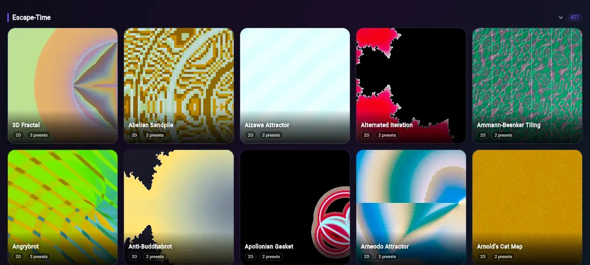
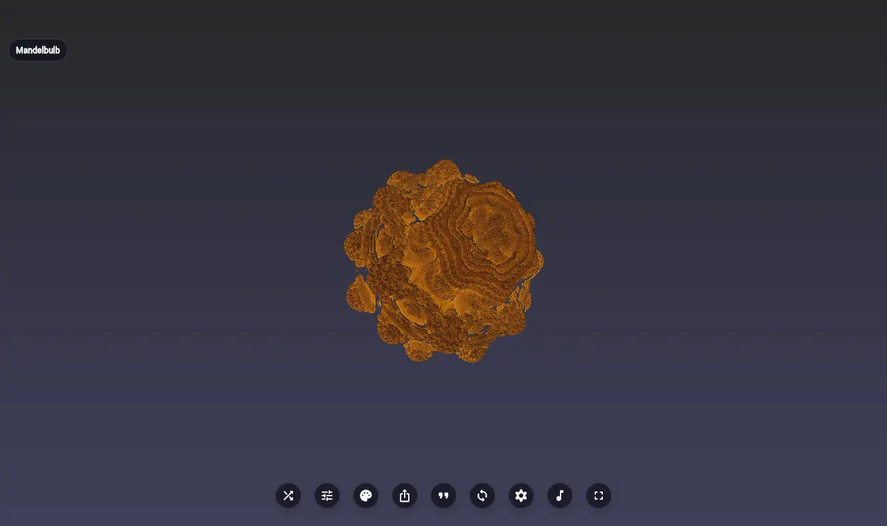

# Fractal Forge

Fractal Forge is an open-source, interactive fractal explorer built with Flutter. Browse **1054 production fractals**, adjust their parameters, and inspect the mathematics behind the view.

- **[Open the web preview](https://fractal.trebuchetdynamics.com)** — start in a modern WebGL 2.0 browser. **Preview limitation:** web is not full app parity; export, sharing, CPU precision, deep zoom and hardware GPU behavior remain incompletely qualified. See the [backend matrix](docs/engineering/rendering/renderer_backend_matrix.md).
- **[Get the Android app](https://play.google.com/store/apps/details?id=com.trebuchetdynamics.fractal.forge)** — the primary mobile experience, with fuller platform integrations.
- **[Build locally](#run-it-locally)** — use the pinned Flutter SDK for a browser or installable target.

## See what it renders

Explore the catalog, then open a card that catches your eye.



*Existing browser screenshot, not current UI or platform-parity evidence. [View the catalog capture at full size](assets/readme/catalog-grid.webp).*

## Try it

### Browser preview

Start with the **[web preview](https://fractal.trebuchetdynamics.com)** and follow one short path:

1. **Browse** — pick a catalog card to open its viewer.
2. **Adjust** — drag to pan in 2D or rotate in 3D; pinch or scroll to zoom. Open parameter controls to change iterations, palette, a preset or formula-specific settings.
3. **Inspect** — read the current rule/formula and any unverified or inspired qualification. A colorful preview is not mathematical certification.



*Existing browser screenshot illustrating the viewer, not a guide to today's button layout or export qualification. [View the viewer capture at full size](assets/readme/viewer-controls.webp).*

### Android

Install **[Fractal Forge from Google Play](https://play.google.com/store/apps/details?id=com.trebuchetdynamics.fractal.forge)** and follow the same browse → adjust → inspect path. Use an installable target for the fullest export, sharing, wallpaper and precision behavior; availability still depends on the module and platform.

## Run it locally

### Prerequisites

- Flutter SDK matching the [repository toolchain pin](fdroid/flutter.version) ([installation guide](https://docs.flutter.dev/get-started/install))
- Bundled Dart from that Flutter SDK; do not independently upgrade Dart
- A GPU or emulator with shader support: WebGL 2.0 for browsers, or compatible GPU drivers for installable targets

For provisioned offline work, use the [common offline setup](AGENTS.md#common-offline-integration-gate). It selects the existing pinned SDK and package cache for the process without installing tools or changing a shared SDK.

```bash
git clone https://github.com/TrebuchetDynamics/flutter-fractal-forge.git
cd flutter-fractal-forge
flutter pub get
flutter run -d chrome    # fastest preview; some app features are unavailable
```

For the fuller app feature set, choose an installable target:

```bash
flutter devices
flutter run -d linux     # or android, macos, windows, ios
```

Once the catalog opens, follow [the first-use sequence](#browser-preview). Use Android or a desktop target when diagnosing platform-specific shaders, export, sharing, wallpaper or precision behavior.

## What makes it useful

- **Explore different mathematical systems** — escape-time formulas, root-finding basins, attractors, IFS, cellular systems, tilings and ray-marched 3D forms.
- **Shape a view** — pan, zoom, presets, 64 color schemes and family-specific parameters, with deeper GPU preview and CPU paths where supported.
- **Keep a result** — image export, sharing and wallpaper tools on supported installable targets. These tools do not establish the cross-platform release gate below.

Experimental tools on main include dual Mandelbrot/Julia views, **Fourier View** (finite image-spectrum analysis) and **Fractal Uncertainty Lab** (finite-mask experiments). Neither numerical tool is audio playback or a continuous-theorem proof. Fourier Music was removed; the silent Camera looper is a separate animation tool. See the [Fourier guide and historical music scope](docs/research/fractal-uncertainty-and-fourier-mode.md).

The existing `gaussian_prime_lattice` viewer now wires **GaussianMoatMap** for bounded prime walking. Integration, test source, dated Linux/Chromium execution and unverified release inclusion are separated in the [Gaussian status](PRD.md#gaussian-moat-walking-visualization). Presence on main does not imply availability in the Play artifact.

### Privacy, accessibility and security

**No ads, tracking, account requirement or data collection.** The production app has no remote analytics or remote crash-reporting SDK. Settings, presets, history and exports can stay on the device; diagnostics are shared only by explicit user action. Read the [privacy policy](https://fractal.trebuchetdynamics.com/privacy-policy) and its [repository source](web/privacy-policy.html) for storage, permissions and sharing details.

Accessibility options include **high contrast, reduced motion, screen-reader labels and configurable touch targets**. Report security concerns through the [security policy](SECURITY.md). The project uses the [Apache 2.0 license](LICENSE).

## Controls

| Gesture | 2D fractals | 3D fractals |
| --- | --- | --- |
| Drag | Pan | Rotate |
| Pinch / scroll | Zoom | Zoom |
| Double tap | 2× zoom anchored to tap | 2× zoom anchored to tap |
| Long press | Set the Julia seed in the dual viewer | Not used |

Common controls include iterations, bailout, power, color scheme, Julia seed, orbit traps, rendering technique and family-specific coefficients.

**Animation:** Play runs the camera looper; hold Play to build or edit its path. A loop needs at least two points. Backgrounding or leaving the viewer stops playback. Reduced motion disables live shader-time animation. The former eight-second parameter-breathing loop is no longer available; see the [viewer behavior](lib/features/viewer/fractal_viewer_screen.dart), [looper controller](lib/features/looper/looper_controller.dart) and [change notes](docs/engineering/release/PLAY_1.1.121.md#what-changed-since-the-published-11120).

## Explore the catalog

| Family | Examples |
| --- | --- |
| Escape-time | Mandelbrot, Julia, Burning Ship, Tricorn, Nova, Phoenix, Lyapunov |
| Root finding | Newton, Halley, Householder, Schroeder, Traub–Ostrowski |
| Attractors | Clifford, Peter de Jong, Lorenz, Rössler, Aizawa, Sprott |
| IFS and geometry | Sierpiński, Koch, Barnsley Fern, Hilbert, circle inversion |
| Cellular and number systems | Wolfram rules, Life-like families, Langton systems, Wireworld, Farey and Ulam views |
| Fractalish motion | Arachnid lattices, radial sigils, recursive arcana frames, aurora tides, keyframed metamorphosis |
| 3D and hypercomplex | Mandelbulb, Mandelbox, pseudo-Kleinian, quaternion Julia, KIFS, recursive surfaces |

The count covers stable renderable identities—not palettes, camera angles, presets or thumbnails as separate fractals. See the [system specification](docs/engineering/spec.md) for specialist contracts.

### Number Walls

Open **Number Walls** for six sequence variants of one finite-field determinant visualization. Choose a prime quick pick or enter decimal digits and **Apply**. Invalid or unverified edits, imports and restored sessions retain the previous completed field and committed settings. **Cancel** stops a pending check; **Continue checking** raises its trial-division budget. Large primes are not promised to finish quickly.

Tap a cell, or focus the plot and use arrow keys, to inspect its exact row, column, modulus and residue. Integer computation stays in Dart; GPU mode samples the completed field, CPU mode uses Canvas, and Auto can fall back to Canvas. Self-similarity depends on the sequence and modulus. Cross-platform images, export and installed-device qualification remain separate gates in the [Number Walls contract](docs/engineering/spec.md#number-walls-and-modular-windows).

## From formula to image

Exploration, history and output tools share the selected module's view state. A preview alone does not prove that an exported image matches that state.

### Precision ladder

| Path | Intended use |
| --- | --- |
| Realtime GPU | Interactive pan, zoom and parameter changes |
| Extended GPU preview | Deeper double-float or perturbation-backed preview for supported modules |
| CPU Precision | Slower refinement for modules with a native CPU formula |

Precision is capability-based. A synthetic fallback is **not** CPU Precision. See the [renderer policy](docs/engineering/spec.md#rendering-interface) and [backend matrix](docs/engineering/rendering/renderer_backend_matrix.md) for supported paths and dated evidence.

## Platform support

| Platform | Status | Boundary |
| --- | --- | --- |
| Android | Primary mobile target | Maintained Google Play build path |
| Web | Preview | JavaScript/WebGL 2.0; not full app parity |
| Linux, macOS, Windows | Development targets | Shader behavior depends on GPU and drivers |
| iOS | Build target | Requires Apple signing and Metal-backed Flutter rendering |

**Accepted next-release gate — not yet qualified as a complete cross-platform journey:** browse → customize → understand → PNG-export must pass on Android, web and Linux. The PNG must match the edited view and selected settings, without a crash or silent placeholder substitution. Existing IDs, favorites and saved presets must remain intact. Unverified/inspired entries may remain with clear qualifications. See the [accepted release contract](PRD.md#active-release-contract) and [verification plan](docs/engineering/test-plan.md#accepted-cross-platform-release-journey); neither screenshots nor this support table claim current parity.

## Current development priority

Improve existing quality before expanding the catalog: compact viewer navigation first, then a diverse pilot with attractive defaults, useful controls and matching PNG export. The OpenAI-math shortlist is **proposed, not implemented**. The phone-overlay work from [#30](https://github.com/TrebuchetDynamics/flutter-fractal-forge/issues/30) and children [#31](https://github.com/TrebuchetDynamics/flutter-fractal-forge/issues/31), [#32](https://github.com/TrebuchetDynamics/flutter-fractal-forge/issues/32), [#33](https://github.com/TrebuchetDynamics/flutter-fractal-forge/issues/33) and [#34](https://github.com/TrebuchetDynamics/flutter-fractal-forge/issues/34) is integrated on main: hold Edit to open Controls directly; on phones, choose one selected parameter to adjust while leaving more canvas visible. Short-landscape history and overlay hit areas are also updated. See the [tool bindings](lib/features/viewer/chrome/viewer_tools.dart), [parameter HUD](lib/features/viewer/chrome/fractal_controls_hud.dart) and [history sheet](lib/features/history/history_sheet.dart); source integration is not release-inclusion or device qualification evidence. Gaussian map/walk code is integrated on main; local evidence is not full platform qualification or release-inclusion proof. See [the owner decision](PRD.md#quality-first-planning-priority), [scoped Autowork tasks](tasks/items/), [workflow queue owners](docs/README.md#queues-and-history) and [verification plan](docs/engineering/test-plan.md).

## Architecture

Flutter's app shell uses Provider services. `CatalogRepository` and `ModuleRegistry` supply each `FractalModule`; the viewer uses shared controller state for rendering, controls, presets, history and output tools. The registry combines declarative configs, shared catalogs, custom builders and debug-only diagnostics.

For directory structure, release builds and shader contributions, use the [contributor guide](CONTRIBUTING.md).

## Testing

The [common offline gate](docs/engineering/test-plan.md#common-offline-gate) starts with checkout-local `flutter pub get --offline --enforce-lockfile` and includes Rust, analyzer, Flutter, Python and Bats checks. These focused commands are **not** the complete gate; device/browser journeys remain separate:

```bash
flutter analyze
flutter test
flutter test integration_test/   # requires a device or emulator
```

See the [test conventions and focused lanes](test/README.md) and the [Linux catalog audit guide](docs/engineering/performance/LINUX_FRACTAL_AUDIT.md) for real-renderer screenshots, frame timings, headless runs and retained GitLab artifacts. GitLab execution remains [deferred by owner policy](PRD.md#active-release-contract).

## Project references

- [Current product contract](PRD.md)
- [Documentation index, workflow queues and history](docs/README.md#queues-and-history)
- [GitHub issues / Orbi delivery](https://github.com/TrebuchetDynamics/flutter-fractal-forge/issues)
- [Renderer backend matrix](docs/engineering/rendering/renderer_backend_matrix.md)
- [Performance engineering docs](docs/engineering/performance/README.md)
- [Shader optimization notes](docs/engineering/performance/SHADER_OPTIMIZATIONS.md)
- [Formula coverage limitation](docs/engineering/rendering/formula_coverage_limitation.md)
- [Scoped Autowork tasks and status](tasks/items/) and [goals](tasks/goals/)
- [Historical task archive](todo.archive.md) — not current eligibility
- [Historical readiness snapshot](docs/planning/PRD.md) and [pipeline state — 2026-04-12](docs/planning/PIPELINE_STATE.md)
- [System specification](docs/engineering/spec.md)
- [Verification plan](docs/engineering/test-plan.md)
- [Local operations runbook](docs/engineering/runbook.md)
- [Fibonacci prime-degree Julia](research/fibonacci-prime-degree-julia.md) — native fixed-c diagonal slice with prime-degree escape bands, finite-budget/numeric legend, CPU RGB rendering and frozen PNG export; CPU transparency is explicitly unavailable. [Local checks and remaining target qualification](docs/engineering/test-plan.md#fibonacci-prime-degree-julia-verification).
- [Launch ladder](docs/planning/LAUNCH_LADDER.md)
- [Contributing guide](CONTRIBUTING.md)
- [Security policy](SECURITY.md)
- [Changelog](CHANGELOG.md)

## Contributing

Contributions are welcome: thumbnail quality, presets, shader correctness, web-preview QA, accessibility, tests and documentation. Read [CONTRIBUTING.md](CONTRIBUTING.md) before opening a pull request.

## License

Apache License 2.0. See [LICENSE](LICENSE).

## Acknowledgments

Built with [Flutter](https://flutter.dev). Shader and fractal techniques are informed by the wider mathematical visualization community, including the educational work of [Inigo Quilez](https://iquilezles.org/).
