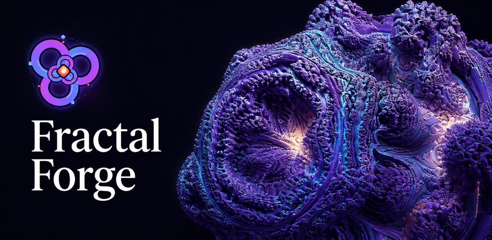
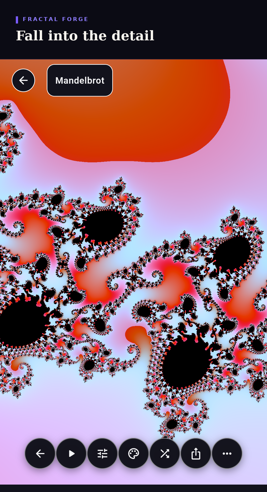
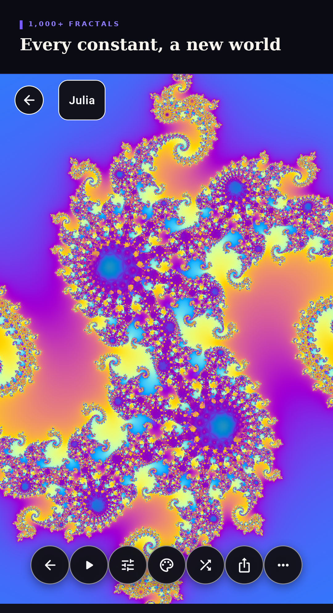
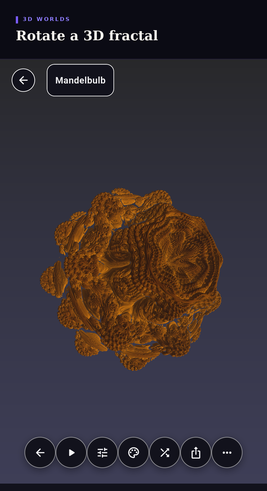
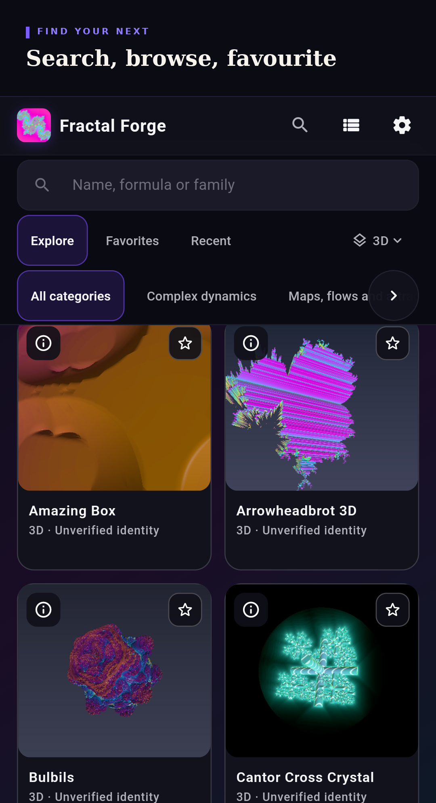
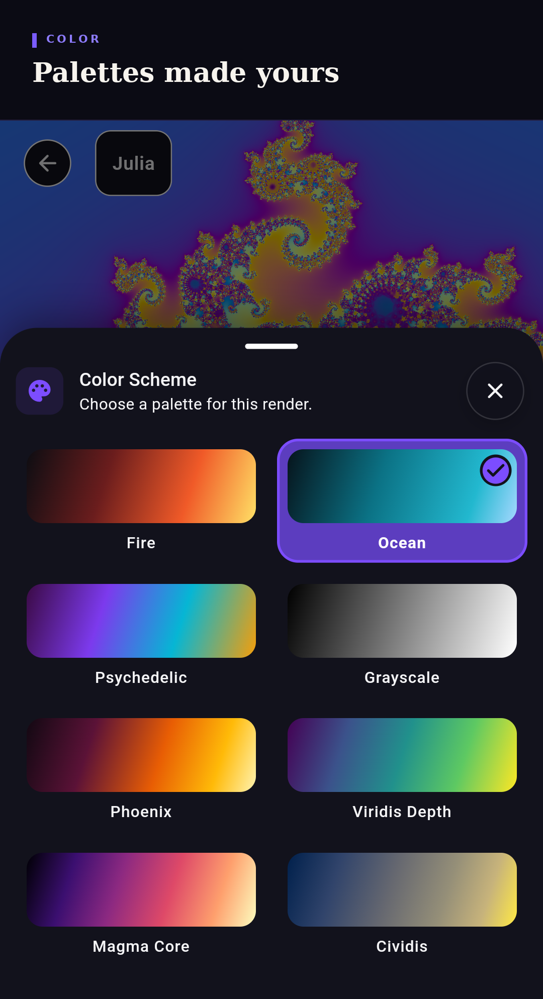
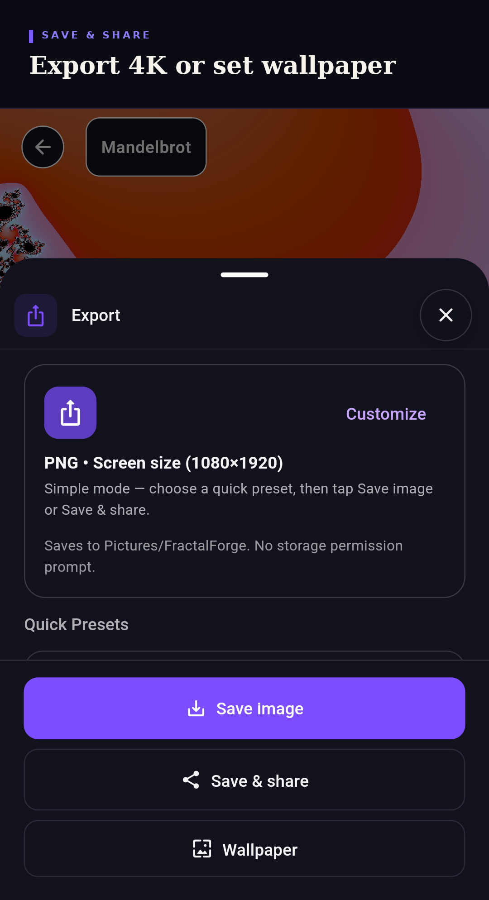
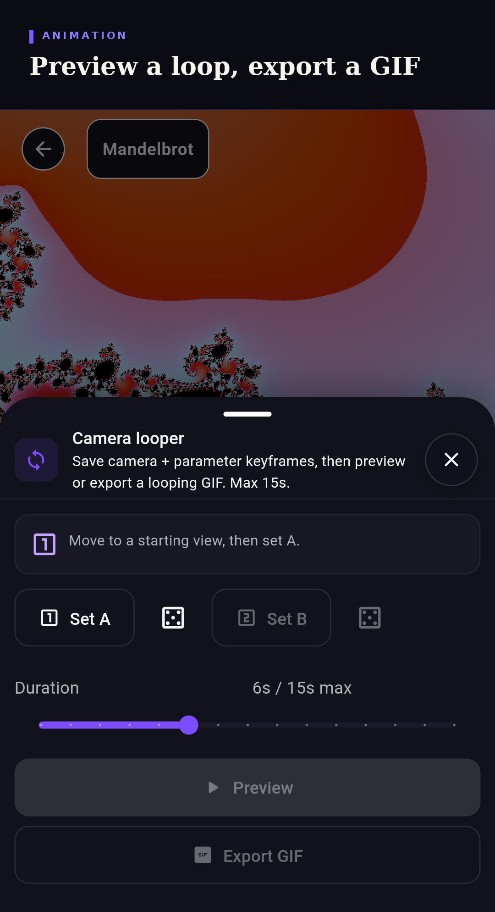

# Fractal Forge

1,000+ fractals: Mandelbrot, Julia, 3D. 4K wallpaper & GIF art, offline, no ads.

## Phone screenshot sequence

| Fall into infinite detail | Every constant, a new world | Rotate a 3D fractal |
|---|---|---|
|  |  |  |

| Search 1,000+ fractals | Palettes made yours | Export 4K or set wallpaper |
|---|---|---|
|  |  |  |

| Preview a loop, export a GIF |
|---|
|  |

## Tablet screenshot sequence

[Catalog](screenshots/tablet/01-catalog.png) · [Mandelbrot](screenshots/tablet/02-mandelbrot.png) · [Mandelbulb](screenshots/tablet/03-mandelbulb.png) · [Julia](screenshots/tablet/04-julia.png)

The headline on each image is baked into a caption band above the unmodified app
capture, and doubles as the image's description here. Google Play's image API
does not accept separate alt text fields.

[Full English description](full_description.txt) · [All 15 translations](../play-store-localized-listings.json) · [Publishing and provenance](README.md)
